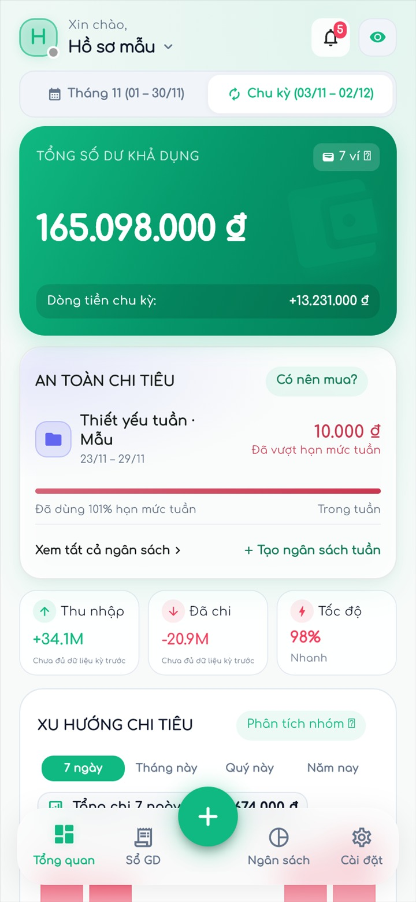
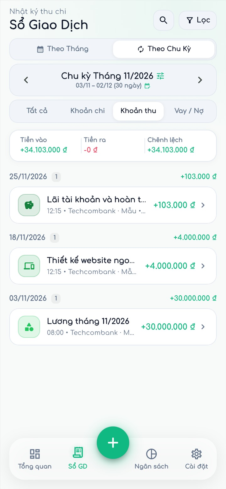
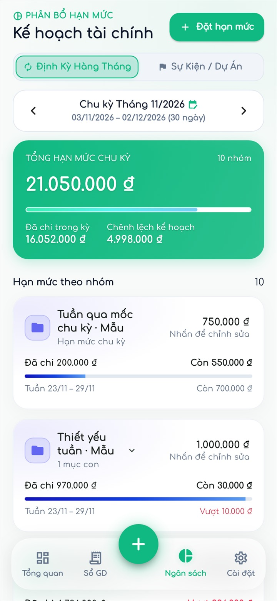
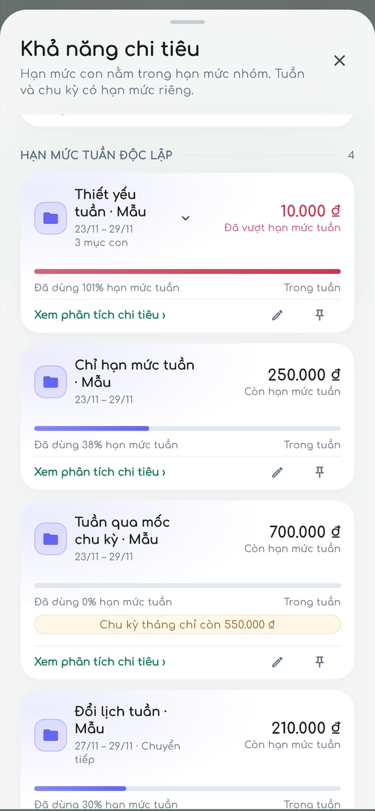

# Flowy


**Quản lý tài chính cá nhân, rõ ràng hơn mỗi ngày.**

Flowy giúp bạn ghi lại thu chi, theo dõi số dư từng ví và thấy mỗi khoản chi ảnh hưởng thế nào đến kế hoạch tài chính. Dữ liệu tài chính chính được lưu trên thiết bị, để bạn có thể ghi chép và xem lại sổ ngay cả khi ngoại tuyến.

## Giao diện

Các ảnh dưới đây được chụp khi chạy giao diện Flowy bằng Flutter test với dữ liệu trải nghiệm trong cơ sở dữ liệu riêng. Đây là bản xem trước của phiên bản đang phát triển.

<a href="docs/assets/readme/flowy-dashboard.jpg"></a>
<a href="docs/assets/readme/flowy-transactions.jpg"></a>
<a href="docs/assets/readme/flowy-budget.jpg"></a>
<a href="docs/assets/readme/flowy-spending-capacity.jpg"></a>

## Flowy giúp bạn làm gì?

- **Nắm tình hình tài chính.** Xem số dư các ví, dòng tiền, xu hướng chi và giao dịch gần đây từ Tổng quan.
- **Ghi và tìm lại giao dịch.** Ghi khoản thu, khoản chi hoặc chuyển giữa các ví. Dùng bộ lọc trong Sổ GD để đối chiếu và sửa giao dịch.
- **Lập kế hoạch chi tiêu.** Đặt hạn mức theo chu kỳ cho các nhóm chi. Mở phần theo dõi ngân sách từ Tổng quan để xem tiến độ và cân nhắc khoản mua.
- **Hiểu thói quen chi tiêu.** Xem báo cáo theo khoảng thời gian, ví hoặc nhóm, rồi mở các giao dịch tạo nên con số.
- **Tách ngân sách sự kiện và dự án.** Dành một kế hoạch riêng cho chuyến đi hoặc khoản mua lớn và theo dõi các giao dịch liên quan.
- **Quản lý vay và nợ.** Xem lịch sử theo từng đối tác, ghi phát sinh, thu nợ hoặc trả nợ.

Từ **Cài đặt → Tạo dữ liệu trải nghiệm đầy đủ**, bạn có thể khám phá các màn hình với dữ liệu mẫu. Dùng hồ sơ thử riêng nếu muốn giữ báo cáo cá nhân chỉ gồm giao dịch của mình.

### Cách Flowy trình bày kế hoạch

Hạn mức cho biết bạn dự định chi bao nhiêu và đã dùng bao nhiêu. Số dư ví cho biết tiền đang được ghi nhận trong các nguồn tiền của bạn. Khi xem một con số, hãy kiểm tra nó thuộc ví, tuần hay chu kỳ nào.

## Phát triển trên Android

Flowy dùng **Flutter**, **Dart**, **Riverpod** và **Drift/SQLite**. Lockfile của nhánh này yêu cầu Flutter 3.44+ và Dart 3.12+. Chuẩn bị Android SDK, JDK 17 và một thiết bị Android hoặc emulator dùng cho phát triển.

Sau khi clone repository, mở terminal tại thư mục dự án và chạy các lệnh sau.

```sh
flutter pub get
flutter devices
flutter run
```

Dùng các lệnh sau để phân tích mã và chạy kiểm thử.

```sh
flutter analyze
flutter test
```

## Trạng thái phát triển

Flowy đang ở giai đoạn beta. Nhánh công khai hiện có ngân sách chu kỳ, theo dõi chi tiêu và các luồng ghi chép ở trên. Bộ ảnh giới thiệu còn minh họa hướng đang phát triển với hạn mức tuần độc lập, nhóm hạn mức mẹ/con và các cảnh báo giới hạn trong Khả năng chi tiêu. Những thay đổi này chưa có trong mã của nhánh mặc định.
